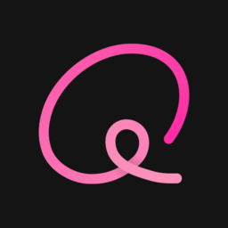

  

<h1 align="center">qubeDesk</h1>

Удалённый доступ qubeOS — помочь коллеге или партнёру, не выходя из-за своего стола

---

## Скачать

Готовые программы лежат в разделе **[Релизы](../../releases/latest)**:

| Компьютер | Файл |
|---|---|
| Windows 10 и 11 | `qubedesk-…-x86_64.exe` |
| Mac с процессором Apple (M1, M2, M3, M4) | `qubedesk-…-aarch64.dmg` |
| Mac с процессором Intel | `qubedesk-…-x86_64.dmg` |

Не знаете, какой у вас Mac? Меню  → «Об этом Mac»: в строке «Процессор» или «Чип» будет написано Apple или Intel.

## Как пользоваться

1. Установите qubeDesk на оба компьютера: тот, **с которого** помогают, и тот, **которому** помогают.
2. Тот, кому помогают, называет свой **номер** и **пароль** из окна qubeDesk.
3. Тот, кто помогает, вводит номер, нажимает «Подключиться» и вводит пароль.

На Mac при первом запуске система попросит разрешить qubeDesk запись экрана и управление компьютером — без этого помочь не получится.

## Почему qubeDesk, а не обычные программы

- Связь идёт **только через сервер qubeOS** — чужие серверы программа не использует, сторонние сервисы ваш экран не видят.
- Соединение **зашифровано** от компьютера до компьютера.
- Без подписок и ограничений по времени сеанса.

## Вопросы

Пишите в поддержку в qubeOS.

---

qubeDesk основан на открытой программе [RustDesk](https://github.com/rustdesk/rustdesk) © Purslane Tech Pte. Ltd. и распространяется по той же лицензии [AGPL-3.0](LICENCE): исходный код всех наших изменений — в этом хранилище. Исходное описание RustDesk — в [docs/README-rustdesk.md](docs/README-rustdesk.md).
